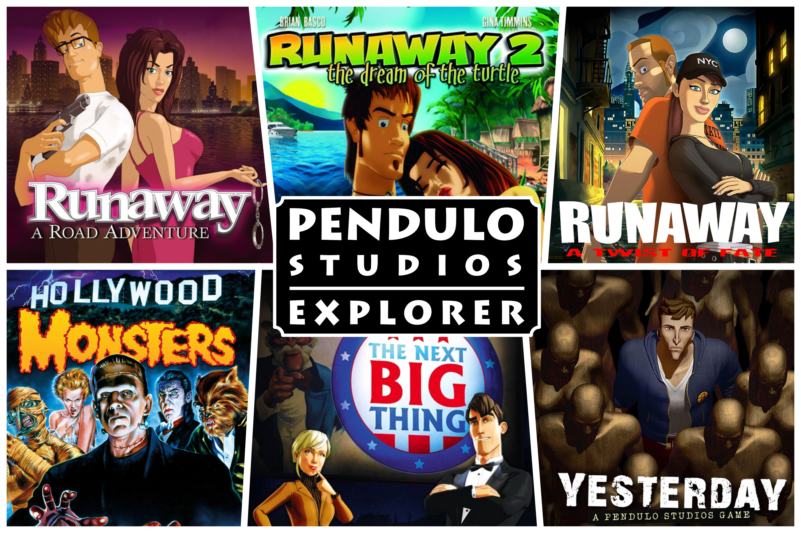

<p align="center"></p>

# Runaway Explorer

[](https://github.com/Victor-Gomez/Runaway-Explorer/actions/workflows/ci.yml)
[](https://github.com/Victor-Gomez/Runaway-Explorer/releases/latest)
[](https://dotnet.microsoft.com/)
[](#download)
[](LICENSE)

A cross-platform viewer for the game assets of the *Runaway* trilogy and the other adventure games by Pendulo Studios:
- **Hollywood Monsters** (1997)
- **Runaway: A Road Adventure** (2001)
- **Runaway 2: The Dream of the Turtle** (2006)
- **Runaway: A Twist of Fate** (2009)
- **The Next BIG Thing** (2011)
- **Yesterday** (2012)

Point it at an install for any of the six games (or configure all six in Settings) and browse every scene background, overlay, sprite animation, music track,
sound effect, voice line, lip-sync track and cutscene -- and export any of them.

The games keep everything in nameless offset-table archives with no file names, no extensions and no
headers; the formats were reverse-engineered from the Steam releases and are written up in
[`docs/formats/`](docs/formats/README.md).


## Features

- **Whole-install browsing.** Supports all six games (*Hollywood Monsters*, *Runaway 1*, *Runaway 2*, *Runaway 3*, *The Next BIG Thing*, and *Yesterday*). Every archive is scanned once and its entries classified by what they
  actually are. The tree is organised by kind: Scenes, Music, Ambient & SFX, Cinematic Audio, Voice,
  Lip-sync, Video, Dialogue, Global Data, and — in *Runaway 1* — Characters. Includes a pre-computed hash-based scan cache covering every scene and global archive of all six
  games, so a first launch on a stock install is near-instant instead of a cold scan of several
  hundred megabytes.
- **Backgrounds, scene masks and overlays.** Displays full-screen scene backgrounds, positioned overlays
  (props, foreground layers, title cards, UI), and scene interaction masks (walkboxes, hotspots, depth planes).
  Overlays and scene masks can be drawn directly on their scene's background at authored coordinates, with
  layer filtering and adjustable opacity. *Runaway 1* savegames (`SAVEGAME/`) can be browsed and inspected,
  displaying their 204×120 RGB565 thumbnail, slot name, action verb, scene ID, actor coordinates, and inventory items.
- **Sprite animations.** Frame-by-frame playback with scrubbing, stepping, looping, and adjustable
  frame rate, either on the animation's own bounding box or composited over the scene background at
  authored coordinates. *Runaway 1*'s characters live in a library of their own, in a different codec
  entirely — palette-indexed run streams with a separate coverage mask for the anti-aliased rim and the
  ground shadow — and play in the same viewer. The player character is not in that library: his six
  costumes, each of eight walk cycles and six talking heads, are laid out across `RESOURCE.000` and are
  decoded too.
- **Sound & Video.** Background music, ambient sound effects, cinematic audio, voice acting clips,
  Bink cutscenes with restored headers, and *Hollywood Monsters*' Smacker (`.smk`) videos played via LibVLC with dedicated volume controls and
  interactive waveform seeking.
- **Dialogue & script.** Browse the games' written text: *Runaway 2* and *3* by phrase, *Hollywood
  Monsters* scene by scene, deciphered from its obfuscated script and shown as that scene's hotspot labels
  and spoken lines, each pointing at the voice clip that records it where the script names one, and *Runaway 3*'s
  `RESOURCE.005` chapter interaction database (2,173 records across 7 chapters, deciphered Spanish object names,
  adventure verbs, and visual Mermaid interaction graphs per chapter and scene).
- **Export & Clipboard.** Single entries or whole folders: PNG for images and scene masks, **animated PNG** or
  numbered **image sequence** (with per-frame screen coordinates) for animations, WAV for audio,
  restored `.bik` for video, text for lip-sync tracks, and raw bytes for data tables. Copy images and
  animation frames to the clipboard (Ctrl+C).
- **Quick navigation & localisation.** Full English and Spanish interface with human-friendly chapter
  and scene names for all supported games, resource type filter, name search with quick clear (Esc),
  tree expand/collapse all, clickable status bar paths, a fuzzy command palette (Ctrl+P), keyboard shortcuts,
  and remembered selection per install.
- **Multi-game configuration.** Switch between games seamlessly with separate install folder paths
  managed in the Settings dialog and top toolbar selector.
- **Update checks.** Optionally asks GitHub whether a newer release exists, then links you to it. Off
  until you say yes.

## Download

Pre-built, self-contained standalone binaries for **Windows (x64)** and **Linux (x64)** are available on the **[Releases](https://github.com/Victor-Gomez/Runaway-Explorer/releases/latest)** page. No .NET runtime installation is required to run them.

1. Download and extract the archive for your operating system (`RunawayExplorer-v*-win-x64.zip` or `RunawayExplorer-v*-linux-x64.tar.gz`).
2. Run `RunawayExplorer.exe` (Windows) or `./RunawayExplorer` (Linux).

## Building

Requires the **.NET 10 SDK**. Builds and runs on Windows and Linux (Avalonia UI).

```
dotnet build RunawayExplorer.slnx
dotnet run --project src/RunawayExplorer
dotnet test
```

Sound and video playback are backed by [LibVLC](https://www.videolan.org/vlc/libvlc.html). The
Windows build bundles it via NuGet; on Linux, install it from your distro's package manager (e.g.
`sudo apt install libvlc-dev vlc` on Debian/Ubuntu).

## Project layout

- `src/RunawayExplorer.Core/` -- archive readers, image decoders, PNG/APNG/WAV writers and the virtual
  file system. Engine-agnostic: no UI framework, no native dependencies.
  - `FileSystem/` -- the scene, audio, global, viseme, voice, chapter interaction, and savegame archive readers; the video keyfile;
    `VirtualFileSystem` (the categorised tree) and `ScanCache`.
  - `Formats/` -- `RasterDecoder`, `JpegDecoder`, `PngDecoder`, `OverlayDecoder`, `SpriteDecoder`, `CharacterSpriteDecoder`, `RleMaskDecoder`, `RouteDecoder`, `SceneTable`, `CorridorSpanDecoder`, `SmackerVideo`, `PngWriter`, `ApngWriter`, `WavWriter`.
  - `Metadata/` -- `SceneCatalog` (official chapter names, scene titles and bilingual descriptions).
  - `Settings/` -- persisted user preferences.
- `src/RunawayExplorer/` -- Avalonia UI.
  - `MainWindow.axaml` + code-behind -- the browser and the image, animation, sound, video and text viewers.
  - `Services/` -- resource loading, batch export, LibVLC glue, update check, localisation, logging.
  - `Views/` -- settings overlay, animation export overlay, command palette, about, shortcuts, message box, zoom controller.
- `tests/` -- xUnit suites for both projects; the UI suite runs real windows headlessly.
- [`docs/formats/`](docs/formats/README.md) -- specifications for all reverse-engineered engine containers, image codecs, masks, audio, and video formats.

## What is not decoded

- The scene tables in *Runaway* are all understood: 1536 bytes is the six-page zone attribute table,
  43659 bytes (R1) and 335529 bytes (R2) are precomputed waypoint walk matrices, and 704 bytes is
  the 117-span walkway perspective corridor table. *Hollywood Monsters*' equivalents are understood
  too: its playable scenes open with a fixed background, palette, region map, lookup pages and metadata block.
- The localised text bitmaps in `RESOURCE.000`, shown as hex dumps, and the second character sprite
  library in that same file, whose per-animation data bases have not been found
  ([global-data.md](docs/formats/global-data.md)). Interface art itself decodes in every game -- the fonts, cursor atlases,
  full-screen and UI rasters and interface animations of *Runaway 1* and *Runaway 2*,
  *Runaway 3*'s fonts, animations and bitmaps, the PNG and JPEG artwork in *The Next BIG Thing*'s and *Yesterday*'s
  `RESOURCE.IFZ`, and *Hollywood Monsters*' menu panel -- as does the tail of *Hollywood Monsters*'
  `RESOURCE.000`, whose last 14 entries are resident sound effects and play normally.
- Which character palette each *Hollywood Monsters* scene uses. The choice is compiled into `Monsters.exe`
  and is not recoverable from the archives, so some scenes tint their cast wrong above colour 207.
- Animation timing. The files carry none; playback and APNG export use the rate you choose (15 fps by default).

## Author

Developed by **Victor Gomez** ([@Victor-Gomez](https://github.com/Victor-Gomez)).

## Acknowledgements

The formats were worked out by reading the archives and the game executable; there was no prior
public documentation to build on. The single most useful lesson is recorded at the end of
`docs/formats/README.md`: if a decoder needs a heuristic to find where an image starts, look again at
the container.

*Hollywood Monsters*, *Runaway: A Road Adventure*, *Runaway 2: The Dream of the Turtle*, *Runaway: A Twist of Fate*, *The Next BIG Thing*, and *Yesterday* are trademarks of their respective owners. This is an unaffiliated fan-made
tool and ships no game data.

The UI icons are from **[Lucide](https://lucide.dev)** (ISC licensed).
 
## License

This project is licensed under the [MIT License](LICENSE).
